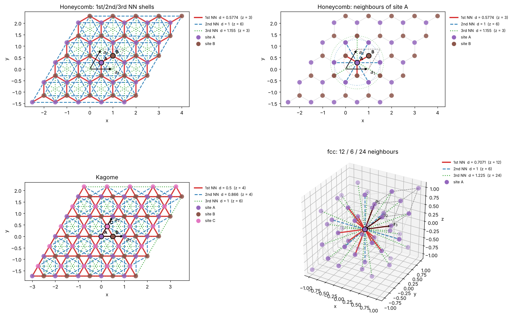

# hopforge

**Forge any tight-binding Hamiltonian, from 1D chains to 3D crystals.**

hopforge is a general, easy-to-use Python engine for tight-binding models. You can define
any lattice, any set of orbitals, spin, spin-orbit coupling, magnetism and Slater-Koster
s/p/d bonding in a few lines. On top of that it computes band structures, DOS,
edge and surface states, topological invariants (Berry phase, Chern, Z2, Wilson loops,
winding) and intrinsic Kubo Hall responses (anomalous, spin and orbital Hall). It ships
**28 published models** and **7 tutorial notebooks, each followed by a 20-question quiz**.



## Install

```bash
git clone https://github.com/Gokaran-Shukla/hopforge
cd hopforge
pip install -e ".[notebooks,test]"
pytest            # 21 physics regression tests
```

## Quick start

```python
import numpy as np
import hopforge as hf

# any model from scratch
lat = hf.Lattice([[1, 0], [0.5, np.sqrt(3) / 2]], [("A", [1/3, 1/3]), ("B", [2/3, 2/3])])
g = hf.Model(lat)
g.add_neighbors(-1.0, shell=1)          # every NN bond (h.c. added automatically)
g.add_onsite(0.2, "A").add_onsite(-0.2, "B")
hf.plot_lattice(g)                      # 1st / 2nd / 3rd neighbour shells

# or one of the 28 published models
h = hf.models.haldane(t2=0.1, phi=np.pi / 2, M=0.1)
h.plot_bands(["G", "K", "M", "G"])
hf.chern_number(h, occ=1)               # 1.0
hf.anomalous_hall(h, mu=0.0)            # sigma_xy = -1 e^2/h
hf.z2_invariant(hf.models.kane_mele(), occ=2)     # 1
hf.z2_3d(hf.models.diamond_fkm(), occ=2)          # (1, 1, 1, 1)
hf.spin_hall(hf.models.kane_mele(), mu=0.0)       # -1 (hbar/e) e^2/h
hf.orbital_hall(hf.models.p_orbital_square())     # finite OHC without SOC

# geometry
rib = h.ribbon(1, 30)                   # 1D ribbon (edges), also .slab / .finite / .supercell
```


## What it can do

| Area | Features |
|---|---|
| **Building models** | Any dimension (0D–3D, also 2D embedded in 3D), any orbitals, automatic neighbour shells, scalar / spin-matrix / Pauli-vector amplitudes, block (k·p-style) matrices, exchange & Zeeman, Rashba, Kane-Mele-type SOC, on-site L·S, Slater-Koster s/p/d tables, Peierls phases, Wannier90 `_hr.dat` export |
| **Geometry** | Supercells (any integer matrix), ribbons, slabs, finite flakes, vacancies, Anderson disorder, magnetic supercells |
| **Spectra** | k-paths from special points, band plots coloured by any operator (spin, L, orbital or edge weight), DOS and projected DOS, Fermi level, gaps |
| **Topology** | Berry phase, Zak phase, polarisation, Berry curvature (Kubo) and maps, Chern number (Fukui-Hatsugai-Suzuki), Wilson loops / hybrid WCC, Z2 (largest-gap method), 3D (ν0;ν1ν2ν3), Fu-Kane parity criterion, 1D winding numbers |
| **Transport** | Intrinsic AHC, SHC and OHC (any components), μ scans with one diagonalisation, broadening, temperature, units e²/h (2D) and S/cm (3D) |
| **Visualisation** | Lattice with 1st/2nd/3rd neighbour shells (1D arcs, 2D, 3D), highlight mode with coordination circles, bands, DOS, WCC flow, k-space maps |
| **Learning** | 7 executed tutorial notebooks, 140 quiz questions (clickable in Jupyter) |

## Model library

```python
hf.models.list_models()
m = hf.models.get("bhz", M=1.0, B=1.0)
```

| 1D | 2D | 3D |
|---|---|---|
| chain, SSH, Rice-Mele, Kitaev chain, Creutz ladder | square, triangular, honeycomb/graphene, Haldane, Kane-Mele, QWZ, BHZ, kagome (+SOC), Lieb, checkerboard, dice/α-T3, AB bilayer graphene, Rashba (ferro)magnet, d-wave altermagnet, Hofstadter, p-orbital square (orbital Hall) | simple cubic, bcc, fcc, Fu-Kane-Mele diamond TI, Wilson-Dirac (Bi2Se3-type) TI, Weyl semimetal, pyrochlore |

Every model is an ordinary `Model`, so you can add terms, cut ribbons or build supercells from it.

## Tutorials and quizzes

| Notebook | Topic |
|---|---|
| [01](tutorials/01_lattices_and_models.ipynb) | Lattices, orbitals, hoppings, neighbour shells, spin, SOC, Slater-Koster |
| [02](tutorials/02_bands_and_dos.ipynb) | k-paths, band structures, DOS/PDOS, Fermi level, altermagnet spin splitting |
| [03](tutorials/03_supercells_ribbons_edges.ipynb) | Supercells, zigzag/armchair ribbons, chiral & helical edge states, flakes, Hofstadter butterfly |
| [04](tutorials/04_model_zoo.ipynb) | Tour of all 28 models |
| [05](tutorials/05_berry_phase_and_chern.ipynb) | Zak phase, polarisation, Thouless pump, Berry curvature, Chern numbers, Haldane phase diagram |
| [06](tutorials/06_wilson_loops_and_z2.ipynb) | Wilson loops, WCC, 2D and 3D Z2, Fu-Kane parity, TI surface states |
| [07](tutorials/07_kubo_hall_transport.ipynb) | Anomalous, spin and orbital Hall conductivities, Weyl AHC in S/cm |

Each notebook ends with a 20-question quiz:

```python
quiz = hf.Quiz(5)
quiz.interactive()          # clickable in Jupyter
quiz.check({1: "b", 2: "d"})  # or grade text answers, with explanations
```

The notebooks are generated by `tools/build_tutorials.py` (`--execute` re-runs them).

## Conventions

* k-points are in reduced coordinates (units of reciprocal vectors) unless `cartesian=True`.
* Bloch Hamiltonian in the atomic gauge, `H_ij(k) = Σ_R t_ij(R) e^{ik·(R + r_j − r_i)}`. `gauge="periodic"` drops orbital positions.
* Spinful basis is orbital-major: index = 2·orbital + spin.
* ħ = 1, spin s = σ/2. Lengths in Å for S/cm conversion.
* Berry curvature follows Xiao, Chang & Niu (RMP 2010), and Hall conductivities follow the Wannier90 sign convention, so σ_xy = −C e²/h in 2D.

## Validation

`tests/test_physics.py` checks the package against known results: analytic dispersions,
flat bands, a finite-difference velocity operator, the Slater-Koster tables, supercell
band folding, Chern numbers of Haldane, QWZ and Hofstadter (1, −2, 1), SSH/Kitaev winding
numbers, Z2 for Kane-Mele and BHZ, (1;000) for the Wilson-Dirac TI, (1;111) and (0;111)
for Fu-Kane-Mele, the Weyl AHC, quantised AHC and SHC, and a finite OHC.

## License

MIT © Gokaran Shukla
