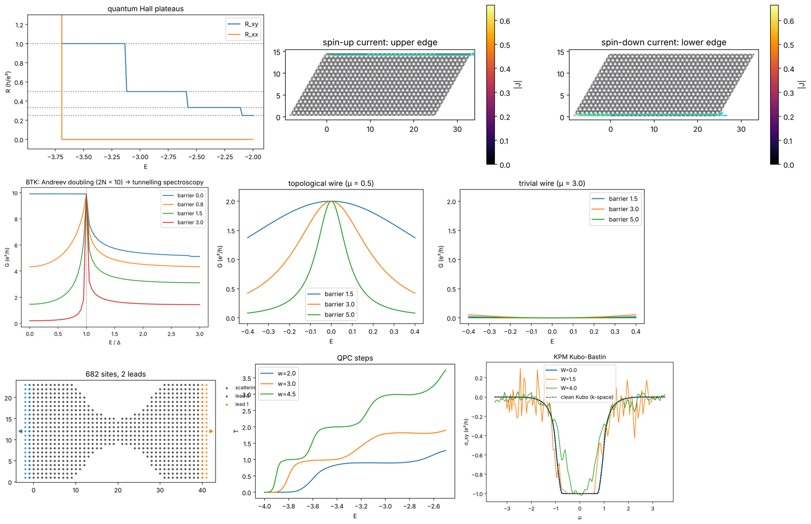

# hopforge

**A universal tight-binding engine: from 1D chains to 3D crystals and Wannier90 models.**

[](https://github.com/Gokaran-Shukla/hopforge/actions)


hopforge builds **any** tight-binding Hamiltonian in a few lines: any lattice, orbitals, spin,
spin-orbit coupling, magnetism, Slater-Koster s/p/d bonding, a k·p model to discretise, or a
DFT Wannier90 model. Every tool works on all of them:

| Area | What you get |
|---|---|
| **Models** | `Lattice`/`Model` engine (0D–3D, spinful, matrix hoppings), 40+ published models (incl. Bernevig, Vishwanath, Sachdev groups), Slater-Koster s/p/d, BdG builder, `make_spinful`, `register_model` for community models |
| **DFT interface** | Wannier90 `hr.dat` / `tb.dat` / centres / `.win`, POSCAR, `hr.dat` export |
| **Spectra** | Bands with operator weights, DOS/PDOS, Fermi level, supercells, ribbons, slabs, flakes, disorder, vacancies, Peierls fields |
| **Topology** | Berry phase, Zak, polarisation, Berry curvature, Chern (FHS), Wilson loops/WCC, 2D and 3D Z2, Fu-Kane parity, winding numbers |
| **Response** | Kubo AHC/SHC/OHC; Boltzmann σ, Seebeck, κ, Lorenz; Edelstein (spin and orbital, extrinsic and intrinsic); Berry curvature dipole (nonlinear Hall); orbital moment and modern orbital magnetisation; optical conductivity |
| **Quantum transport (Kwant-style)** | Scattering regions of any shape, semi-infinite leads, value functions with parameters, Landauer-Büttiker multi-terminal conductance, Hall bars, arbitrary magnetic fields, spin/e-h conservation laws, Andreev/BTK, transmission eigenvalues, shot noise, LDOS, wavefunctions, bond currents, spectra |
| **Large scale** | Sparse Hamiltonians; KPM DOS/LDOS/projected DOS; Kubo-Bastin conductivity (with symmetry-projected noise reduction) |
| **Surfaces** | WannierTools-style surface/bulk spectral functions, spin-resolved spectra, Fermi-arc maps |
| **Many-body / driven** | Self-consistent mean-field Hubbard (collinear and noncollinear); Floquet (exact Sambe space and high-frequency effective models, usable with all topology tools) |
| **Strong correlations** | Exact diagonalisation: Hubbard / extended Hubbard / Kanamori, spinless fermions (fractional Chern insulators), XXZ / J1-J2, Pauli-string models (transverse-field Ising, Kitaev honeycomb), SYK; Lanczos Green functions; Bose-Hubbard mean field |
| **Quantum phases** | Hubbard phase diagrams vs U and doping (PM/FM/AFM), Stoner criterion, Binder cumulants, fidelity susceptibility, entanglement and central charge, Mott lobes, topological phase maps |
| **Moiré & orbitronics** | Bistritzer-MacDonald and chiral TBG magic angles; real-space twisted/stacked bilayers with orbital and spin-frame rotation; layer-resolved Kubo-Středa responses; spin-orbit, orbital and self torques (torkance) |
| **Continuum** | `hf.discretize("k_x**2 + ... sigma_x ...")`: k·p → tight binding |
| **Parallel** | `n_jobs=40` on any sweep, k-mesh, Wilson loop, disorder average or KPM run; one BLAS thread per worker; SLURM example included |
| **Validation** | 59 benchmarks against published results ([BENCHMARKS.md](BENCHMARKS.md)) and 110 tests |
| **Learning** | 20 executed tutorial notebooks (four of them step-by-step "build your own Hamiltonian" walkthroughs), each followed by a 20-question quiz (400 questions) |


## Install

```bash
git clone https://github.com/Gokaran-Shukla/hopforge
cd hopforge
pip install -e ".[notebooks,test]"
pytest -q                          # 110 tests
python -m hopforge.benchmarks -j -1   # 59 published results
```

## Quick tour

```python
import numpy as np, hopforge as hf

# build any model
lat = hf.Lattice([[1, 0], [0.5, np.sqrt(3)/2]], [("A", [1/3, 1/3]), ("B", [2/3, 2/3])])
g = hf.Model(lat); g.add_neighbors(-1.0, shell=1)
hf.plot_lattice(g)                                   # 1st / 2nd / 3rd neighbour shells

# or take a published one / a DFT Wannier model
h  = hf.models.haldane(t2=0.1, phi=np.pi/2)
w90 = hf.io.read_wannier90("Bi2Se3_hr.dat", lattice="POSCAR", positions="Bi2Se3_centres.xyz", spinful=True)

hf.chern_number(h, occ=1)                            # 1
hf.z2_3d(hf.models.diamond_fkm(), occ=2, n_jobs=40)  # (1, 1, 1, 1)
hf.anomalous_hall(h, mu=0.0, nk=300, n_jobs=40)      # -1 e^2/h
hf.orbital_hall(hf.models.p_orbital_square())        # orbital Hall without SOC
hf.response.berry_curvature_dipole(model, mu, kT)    # nonlinear Hall
hf.response.edelstein(model, model.spin_operator("y"), "x", mu=-2)
hf.surface.spectral(hf.models.wilson_dirac_ti(), direction=2, kpath=["X", "G", "M"])
```

### Quantum transport, KPM, many-body, Floquet

```python
from hopforge import transport as tr, kpm

s = tr.System(hf.models.square(), lambda r: 0 <= r[0] < 60 and 0 <= r[1] < 30,
              onsite=lambda r, n, V: V if abs(r[0] - 30) < 4 else 0)       # gate as a parameter
s.attach_lead((-1, 0)); s.attach_lead((1, 0))
T  = s.conductance(np.linspace(-4, 0, 400), params=dict(V=0.5), n_jobs=40)
S  = s.smatrix(-1.0, params=dict(V=0.0))
S.transmission(1, 0), S.shot_noise(), S.current(0), S.ldos()

E, rho = kpm.dos(hf.models.honeycomb().supercell([300, 300]).hamiltonian_sparse(), n_jobs=40)

af = hf.meanfield.hubbard(hf.models.honeycomb().make_spinful(), U=3.0, filling=0.5,
                          init={"A": (0, 0, 1), "B": (0, 0, -1)})
fl = hf.floquet.EffectiveModel(hf.models.honeycomb(), hf.floquet.circular(0.4, 10.0))
hf.chern_number(fl, 1)                                # light-induced Chern insulator
```




## Running on a 40-core node

```bash
#SBATCH --cpus-per-task=40
export HOPFORGE_NJOBS=40          # default n_jobs for every parallel routine
python my_script.py
```
Workers are forked processes with one BLAS thread each, so closures and lambdas work and
nothing is oversubscribed. Parallel and serial runs give identical results. See
[examples/slurm_40cores.sh](examples/slurm_40cores.sh).

## Benchmarks against published results

`python -m hopforge.benchmarks` reproduces **37 published results** across electronic
structure (graphene v_F, McCann bilayer gap, Vogl sp³s* silicon gap 1.17 eV, Lieb/kagome
flat bands, zigzag/armchair ribbons), topology (Haldane boundary, TKNN Hofstadter integers,
Kane-Mele, BHZ, Fu-Kane-Mele, Bi₂Se₃, Guo-Franz kagome TI, SSH, Kitaev, Thouless pump),
response (quantised AHC/SHC, Weyl AHC, graphene σ₀ = e²/4ħ, valley orbital moment, Středa,
Wiedemann-Franz, KPM Kubo-Bastin), transport (conductance quantisation, quantum Hall
R_xy = h/νe², QSH 2e²/h, Fano 1/3, BTK Andreev doubling, Majorana 2e²/h) and many-body or
driven systems (mean-field U_c = 2.23t, Slater gap, Floquet Chern insulator). The full table
with references and deviations is in [BENCHMARKS.md](BENCHMARKS.md). The suite also runs in CI.

## Tutorials (each ends with a 20-question quiz)

| # | Topic |
|---|---|
| [01](tutorials/01_lattices_and_models.ipynb) | Lattices, orbitals, neighbour shells, spin, SOC, Slater-Koster |
| [02](tutorials/02_bands_and_dos.ipynb) | k-paths, bands, DOS/PDOS, Fermi level, altermagnet |
| [03](tutorials/03_supercells_ribbons_edges.ipynb) | Supercells, ribbons, edge states, flakes, Hofstadter butterfly |
| [04](tutorials/04_model_zoo.ipynb) | The model library |
| [05](tutorials/05_berry_phase_and_chern.ipynb) | Berry phase, polarisation, pumping, Chern numbers |
| [06](tutorials/06_wilson_loops_and_z2.ipynb) | Wilson loops, 2D/3D Z2, Fu-Kane parity |
| [07](tutorials/07_kubo_hall_transport.ipynb) | Anomalous, spin and orbital Hall conductivities |
| [08](tutorials/08_scattering_and_leads.ipynb) | Scattering regions, leads, QPC, localisation |
| [09](tutorials/09_multiterminal_quantum_hall_qsh.ipynb) | Hall bars, quantum Hall and QSH devices |
| [10](tutorials/10_superconductors_ldos_wavefunctions.ipynb) | Andreev/BTK, Majoranas, LDOS, wavefunctions, currents |
| [11](tutorials/11_kpm_and_continuum.ipynb) | KPM on 10⁵ orbitals, Kubo-Bastin, k·p discretisation |
| [12](tutorials/12_parallel_parametric_noise.ipynb) | Parallel sweeps, parameters, magnetic gauges, shot noise |
| [13](tutorials/13_wannier90_and_surface_states.ipynb) | Wannier90 import, surface states, Fermi arcs |
| [14](tutorials/14_boltzmann_thermoelectric_edelstein.ipynb) | Boltzmann transport, thermoelectrics, Edelstein |
| [15](tutorials/15_nonlinear_hall_orbital_optical.ipynb) | Berry curvature dipole, orbital magnetism, optics |
| [16](tutorials/16_meanfield_hubbard_and_floquet.ipynb) | Mean-field Hubbard, Floquet engineering |
| [17](tutorials/17_step_by_step_build_a_new_hamiltonian.ipynb) | **Step by step:** build a new model from a paper (Weeks-Franz Lieb TI): lattice, shells, SOC, symmetry checks, bands, Z2, edges, transport, phase diagram, registering it |
| [18](tutorials/18_step_by_step_orbitronics_bilayers_moire.ipynb) | **Step by step:** orbital/spin Hall layers, FM/light-metal bilayer, layer-resolved Edelstein, SOT / orbital torque / self-torque, twisted magnetic bilayer |
| [19](tutorials/19_step_by_step_interacting_hamiltonians_phase_diagrams.ipynb) | **Step by step:** interacting Hamiltonians: ED, correlations, gaps, spectral functions, doping, U-doping phase diagram, quantum criticality, Mott lobes |
| [20](tutorials/20_reproduce_research_models_bernevig_vishwanath_sachdev.ipynb) | Reproducing research models: BBH corner charges, FCI, magic-angle TBG, SYK, Ising chain, Kitaev honeycomb |

```python
quiz = hf.Quiz(13); quiz.interactive()     # or quiz.show() / quiz.check({1: "a", ...})
```

## Conventions

* k in reduced coordinates; atomic-gauge Bloch Hamiltonian `H_ij(k) = Σ_R t_ij(R) e^{ik·(R+r_j−r_i)}`.
* Spinful basis orbital-major (index = 2·orbital + spin); ħ = e = k_B = 1; s = σ/2.
* Berry curvature as in Xiao, Chang & Niu (RMP 2010); Hall signs as in Wannier90 (σ_xy = −C e²/h).
* Every function documents its formula and units; see [docs/API.md](docs/API.md).

## Community

Contributions of models, methods, benchmarks, tutorials and quiz questions are welcome: see
[CONTRIBUTING.md](CONTRIBUTING.md). Every physics feature needs a test against a known
result. Register your own models with `@hf.models.register_model(...)`.

hopforge's transport layer follows the design of [Kwant](https://kwant-project.org)
(Groth et al., NJP 16, 063065 (2014)), and the surface module that of WannierTools
(Wu et al., CPC 224, 405 (2018)). Both are independent implementations. hopforge does not
include Kwant's MUMPS solver, its arbitrary site-family builders or qsymm, so use Kwant
itself if you need those.

## Citing

See [CITATION.cff](CITATION.cff).

## License

MIT © Gokaran Shukla
